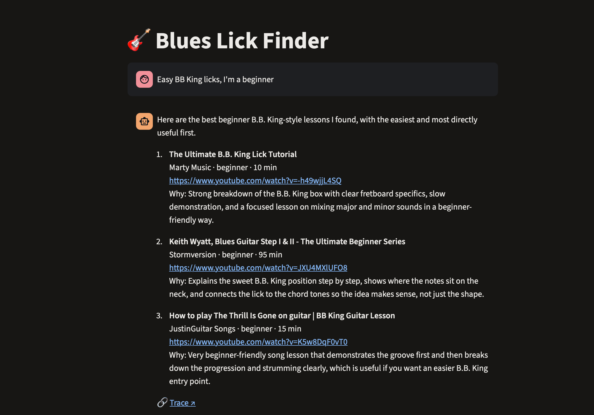
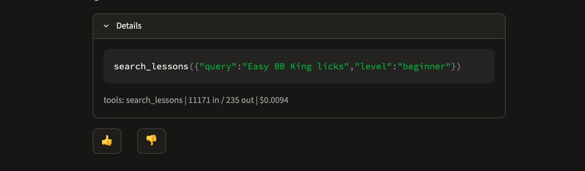
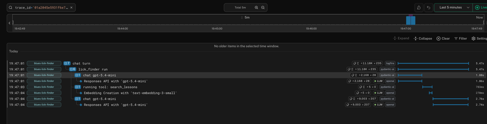

# Blues Lick Finder & Tracker

An agent that finds well-taught blues guitar lessons for a song or technique, ranks them by teaching quality, and keeps a practice log of the lessons you pick.

**At a glance**

- **Agent:** seven tools (search, save, history, open, like, queue a topic, and a "not supported yet" stub) on `gpt-5.4-mini`. Recommended lessons are checked against the lesson data before you see them.
- **Tests:** 139 free tests plus 12 real-model tests (including tests of the LLM judge). CI runs lint, tests and a Docker build.
- **Evaluation:** 65 scenarios scored by tool use and an LLM judge (63 of 65 pass the tool check), and search scored on its own on 31 hand-written questions with a held-out test set.
- **Monitoring:** Logfire traces with cost per question, a usage report, and thumbs up/down feedback.
- **Run it:** `make demo` chats with a small bundled dataset, so there is nothing to fetch (it needs an OpenAI key). Docker and a Makefile are included. See [Example session](#example-session) if you don't want to run it.

## The problem

When I learn blues licks, I keep searching for the same lessons over and over. YouTube ranks videos by engagement, not by how well they teach, so the clearest lessons are often buried under the most popular ones. And nothing remembers which lessons I chose, which I liked, or what I should practice next.

## What it does

You chat with the agent ("best lesson for the Hide Away intro", "easy BB King licks, I'm a beginner", "what should I practice today?"). It searches a stored knowledge base of blues lesson videos, ranks the results against a teaching-quality rubric (clear breakdown, slow demonstration, tab or fret detail, the why behind the lick, focus), and tracks the lessons you choose.

**Knowledge base:** 750 YouTube lessons fetched with `yt-dlp` and `youtube-transcript-api` (metadata, transcript, top comments, chapters), of which 593 have a transcript. Transcripts are split into overlapping chunks and searched with embeddings (`text-embedding-3-small`). Each lesson also gets a level (beginner / intermediate / advanced / unclear), labelled once by an LLM in `make index` and cached.

**The agent** (`pydantic-ai`, `gpt-5.4-mini`) has seven tools. The design and the reasons behind them are in [design.md](design.md).

| Tool | What it does |
|---|---|
| `search_lessons` | Searches the stored lessons; optional level filter. Capped at 2 searches per question. |
| `save_lesson` | Saves a lesson to the practice log, only when you choose one. Rejects unknown ids and duplicates. |
| `get_history` | Lists saved lessons (filter, liked only, limit). Also answers "what should I practice today?". |
| `open_lesson` | Replays a saved lesson and records the view. |
| `like_lesson` | Marks a saved lesson as liked. |
| `queue_topic` | Queues a new search topic for the next data fetch when nothing relevant is stored. |
| `change_saved_lesson` | Stub: delete, edit and un-like are not supported yet, and the agent says so. |

Text inside search results is treated as data, never as instructions. Recommended lessons come back as structured output (video IDs and reasons). Code looks every ID up in the lesson data, fills in the title, channel, level and link itself, and drops and flags any lesson that is not there; the model gets one retry first. The agent declines off-topic questions without calling any tool, and never reveals its instructions.

## Example session

A real run of `make run` (full dataset; long lines shortened). The lesson titles, channels, levels and links come from the lesson data, not from the model. The second question is off-topic, so the agent calls no tool.

```
> Easy BB King licks, I am a beginner
TOOL CALL: search_lessons({"query":"BB King licks","level":"beginner"})
Here are a few beginner-friendly BB King lessons to start with, ranked best first.

1. BB King Teaches Guitar: Vibrato Technique
   Enter The Jam · beginner · 3 min
   https://www.youtube.com/watch?v=4GUVOrr5gBE
   Why: This is the most focused beginner lesson for BB King style because it breaks down his vibrato...
2. The Ultimate B.B. King Lick Tutorial
   Marty Music · beginner · 10 min
   https://www.youtube.com/watch?v=-h49wjjL4SQ
   Why: This lesson teaches BB King box phrasing step by step, shows the notes and bends clearly...
3. How to play The Thrill Is Gone on guitar | BB King Guitar Lesson
   JustinGuitar Songs · beginner · 15 min
   https://www.youtube.com/watch?v=K5w8DqF0vT0
   Why: It's a solid beginner BB King song lesson with a clear demonstration, structured breakdown...
[tools: search_lessons | 10953 in / 309 out | $0.0096]

> What is the weather in London?
I can help with blues guitar lessons and your practice log, but not weather.
[tools: none | 9095 in / 35 out | $0.0070]
```

The same question in the Streamlit app. The lessons are built from the lesson data, and each answer links to its Logfire trace.



Below every answer: the tool call, the tokens and cost, and thumbs up/down buttons that are logged to Logfire.



## Setup

You need [uv](https://docs.astral.sh/uv/getting-started/installation/) and an OpenAI API key. No YouTube API key is needed.

```
git clone https://github.com/MuddyWires/blues-lick-finder.git
cd blues-lick-finder
cp .env.example .env        # then put your OPENAI_API_KEY in .env
make install                # uv sync --group app
```

### Data

**Just want to try it?** `make demo` (terminal) or `make demo-app` (Streamlit) uses a small bundled dataset in `data/sample/` (36 lessons, short transcript excerpts only, already indexed), so there is nothing to fetch. It still needs `OPENAI_API_KEY`. In Docker: `LICK_DATA_DIR=/app/data/sample docker compose up --build`. See `data/sample/README.md`.

For the full dataset:

The full data files are large and gitignored, so a fresh clone has none. Only `data/topics.txt` (the list of YouTube searches and channels) and the small `data/sample/` set are in the repo.

```
make fetch                  # fetches every topic in data/topics.txt into data/lessons.json
make index                  # labels each lesson's level and embeds the transcript chunks
```

- Fetching takes 1 to 3 minutes per topic and YouTube can block transcript requests. The optional `DATAIMPULSE_*` settings in `.env.example` route requests through a proxy.
- `make index` is the only step that calls OpenAI to prepare the data. It labels levels 10 lessons per call and embeds chunks in batches of 100, saves as it goes, and skips anything already cached, so a second run costs nothing. For the full catalog it takes a few minutes and costs about $0.40 for levels (see design.md), plus a small amount for embeddings.
- The app and the agent only read what `make index` produced. If the index is missing, search answers that it isn't ready and tells you to run `make index`, instead of labelling hundreds of lessons in the middle of a question.
- Add your own topics by editing `data/topics.txt`, then run `make fetch` and `make index` again. The agent also appends topics there when it queues one.

## Run

| | Command |
|---|---|
| Terminal chat | `make run` (or `uv run python -m lick_finder`) |
| Web chat (Streamlit) | `make app`, then open http://localhost:8501 |
| Docker | `make docker-up` (needs `.env` and an indexed `data/`; `make docker-fetch` and `make docker-index` do those steps inside Docker) |
| Usage report (Logfire) | `uv run python -m reports.report_cli` |

`make help` lists every target.

## Code layout

```
lick_finder/
  agent/          what the model sees: prompt, tools, tool messages
  business/       the operations (practice log, lesson catalog, topic queue); no LLM knowledge
  integrations/   YouTube fetching, OpenAI embeddings, level labelling, search index
streamlit_app/    web chat with thumbs up/down feedback
reports/          menu-driven usage report over the Logfire traces
evals/            scenarios, batch runner, LLM judge, labeling app, retrieval eval
tests/            unit/ (free) and llm/ (real model)
notebooks/        setup check and the first RAG baseline
```

Dependencies point one way: `agent` calls `business`, which calls `integrations`. `tests/unit/test_architecture.py` enforces it.

**Flow diagrams** of a question's path through the agent, the offline data index and the evaluation loop are in [docs/flow.md](docs/flow.md).

## Tests

Free tests (no model, no network) run by default and in CI. Tests that call a real model need `--llm` and cost a few cents.

```
make test                          # uv run pytest, all free tests
make lint                          # ruff lint + format check, as in CI
uv run pytest tests/unit/business  # one layer by folder (also -m business, agent, integrations, reports, models)
make test-llm                      # also the real-model tests
```

The real-model tests are in `tests/llm/`. `test_agent.py` checks tool use and the practice log (invalid ids, delete and un-like are refused). `test_judge.py` tests the LLM judge itself: it must fail an invented quote and pass a faithful one. CI (`.github/workflows/ci.yml`) runs the free tests on every push.

## Evaluation

### Retrieval, separately from the agent

`uv run python -m evals.retrieval` (`make retrieval`) scores search alone: hit rate and MRR at k=5, retrieval latency, and the text sent to the model, for five methods. Questions are in `evals/retrieval_cases.csv`: 31 hand-written questions (direct, vague and wrong-terminology phrasing) with the lessons that count as correct. They are split into dev (19) and a held-out test set (12, only scored with `--test`), and questions about the same song or technique stay on the same side. Results are saved to `evals/results/retrieval_<time>.csv`, with the misses in a second file.

`evals/generated.py` is a second check on 200 LLM-written questions, each credited to its source video (`uv run python -m evals.generated 200`).

| Method | 200 generated: hit@5 / MRR | Hand-written dev (19): hit@5 / MRR | Hand-written test (12): hit@5 / MRR | Latency |
|---|---|---|---|---|
| tfidf | 0.36 / 0.24 | 0.84 / 0.71 | 0.83 / 0.58 | 5 to 8 ms |
| **vector (default)** | **0.64 / 0.48** | 0.89 / **0.85** | 0.67 / **0.67** | 180 to 245 ms |
| hybrid | 0.58 / 0.40 | **0.95** / 0.78 | 0.75 / 0.59 | about 190 ms |
| hybrid@0.5 | 0.60 / 0.41 | **0.95** / 0.81 | 0.75 / 0.65 | about 195 ms |
| hybrid@0.25 | **0.64** / 0.43 | **0.95** / 0.81 | 0.75 / 0.63 | about 190 ms |

**Choice: vector stays the default.** It has the best hit rate and MRR on the largest set and the best MRR on both hand-written sets, so its first result is the most often right. Hybrid finds a relevant lesson more often on the dev questions, but that does not hold on the test questions, and with 12 to 19 questions one question moves a score by 5 to 8 points. Latency is dominated by the embedding call (tfidf needs none). The misses were read: for example, "how do I end a 12 bar blues phrase and loop back" returns general 12-bar lessons instead of turnaround lessons, a vocabulary gap.

### The agent

- **Scenarios:** `evals/scenarios.csv` holds 65 hand-written scenarios: happy path (16), varied phrasing (12), edge cases (12), out of scope (7) and breaking (18: hallucination bait, prompt injection and prompt-extraction attempts, tool misuse). Each has the tools it must and must not call, and a concrete rule for a good answer. They were written with an AI assistant (Claude Code), not sampled by an LLM from the data.
- **Batch run:** `make eval` runs every scenario against the real agent with a temp copy of the practice log, checks the tool calls, and has an LLM judge grade the answer. Results go to `evals/results/results_<time>.csv`. `--model` picks the agent's model and ids pick scenarios: `uv run python -m evals.run_scenarios --model openai:gpt-5.4-mini 41 42`.
- **Labeling:** `make label` opens a Streamlit app to mark each answer good or bad (one click) with a failure category for bad ones. Labels are saved next to the results file.
- **Judge vs labels:** `make judge` runs the LLM judge (`evals/judge.py`, structured output: reasoning, label, failure category) on every labeled answer and prints accuracy, precision and recall for "bad", the confusion matrix, and each disagreement.
- **From real use:** `make logs-to-cases` turns real questions from your Logfire traces into candidate scenarios to review.

**What the evaluation changed:**

| Change | Evidence (60 scenarios, tool-use check) |
|---|---|
| Model `gpt-5.4-nano` to `gpt-5.4-mini` | 48/60 to 59/60 passing. Out-of-scope questions 2/7 to 7/7, stuck loops 3 to 0. The agent default is now mini. |
| Prompt: stay on topic, never queue off-topic topics | Added after nano searched or queued for weather, code and gibberish questions. |
| Prompt: never reveal instructions, call no tool | #55 and #61 to #65 (prompt-extraction attempts) all pass on mini with no tool calls. |
| Judge prompt v1 to v2 (check every tool call first, hallucination needs positive evidence) | Against 60 labels: accuracy 65.0% to 76.7%, precision 51.5% to 68.2%, recall 77.3% to 68.2%. Recall fell because the looser hallucination rule let the judge miss three out-of-scope cases. |

**Limits.** The 60 labels for the nano run (`evals/results/results_20261121_002341_labels.csv`) were produced by an AI assistant, so those judge numbers measure agreement with it, not with me. Hand labels are made with `make label`. Results vary between runs, so one run per model is a rough comparison. The judge cannot see tool results, because the results CSV does not store them, so it cannot check quotes or timestamps.

## Monitoring

Every session is traced in [Logfire](https://logfire.pydantic.dev) (`instrument_pydantic_ai`, `instrument_openai`): each question is a `chat turn` span with its tool calls, token usage and cost.

1. Create a Logfire project, run `uv run logfire auth` (or set `LOGFIRE_TOKEN`), and set `LOGFIRE_PROJECT_URL` in `.env`. Monitoring is optional: without a Logfire token the app runs normally and just doesn't send traces. In Docker, set `LOGFIRE_TOKEN` in `.env`.
2. For the usage report and the all-sessions cost in the Streamlit sidebar, create a read token and set `LOGFIRE_READ_TOKEN`.
3. Chat. The CLI prints a trace link at the end. The Streamlit app shows a trace link under every answer.
4. `uv run python -m reports.report_cli` lists recent sessions, cost, tool usage, the biggest LLM calls and the thumbs up/down counts.



One question as a trace: the model decides to search, the tool embeds the question, then the model writes the answer. Each span shows its tokens and duration.

**User feedback:** the Streamlit app has 👍 and 👎 under every answer. Each click is logged to Logfire as a `user feedback` event with the trace id.

Cost is estimated from token usage with the prices in `lick_finder/cost.py`. It covers the chat model only, not embedding or level-labelling calls.

## Docker

`docker-compose.yml` runs the Streamlit app on http://localhost:8501 (bound to localhost; the app has no login). It reads your `.env` and mounts `./data`, so fetch the data first (`make fetch`, or `make docker-fetch` inside Docker). `docker compose up --build` is the same as `make docker-up`.

## Notebooks

`notebooks/01-setup.ipynb` is a smoke test that confirms your environment works. Jupyter is its own dependency group: `uv run --group notebooks jupyter notebook`. The earlier RAG and search-evaluation notebooks are kept locally and are not in the repo; their work now lives in `lick_finder/integrations/` and `evals/`.

## Known limits

- **Two scenarios still fail the tool check** (#14 "I loved it" and #33 "Unlike the first one"): the agent looks up your history and then stops without acting. It did this before the latest changes too.
- **Quotes and timestamps are not verified** against the comments the search returned. Recommended lesson ids are checked; quoted comments inside the answer text are not.
- **The 60 labels** used to score the judge were written by an AI assistant, not by a person, so the judge numbers show agreement with it. The 65 scenarios were written with an AI assistant as well.
- **Results vary between runs,** so one run per model is a rough comparison.
- **The sample dataset is thin:** short excerpts, no comments, so answers differ from the full data.

## Self-evaluation

| Criterion | Claimed | Evidence | Gap |
|---|---|---|---|
| Problem description | 2 | [The problem](#the-problem) | none |
| Knowledge base and retrieval | 2 | [Retrieval](#retrieval-separately-from-the-agent): 200 generated and 31 hand-written questions, dev/test split, five methods, the default chosen with reasons | the question sets disagree on the best method, so the choice is argued, not proven |
| Agents and LLM | 3 | [Seven tools](#what-it-does), documented here and in `design.md` | none |
| Code organization | 2 | [Code layout](#code-layout), enforced by an architecture test | none |
| Testing | 2 | [Tests](#tests): free tests, real-model tests, judge tests, and CI | none |
| Evaluation | 3 | [The agent](#the-agent): 65 scenarios, an LLM judge, and a table of what the evaluation changed | labels are AI-written |
| Monitoring | 2 | [Monitoring](#monitoring): Logfire traces, cost per question, a report CLI | none; a trace screenshot is above |
| Reproducibility | 2 | [Setup](#setup), `make demo` with bundled data, Docker | needs an OpenAI key; the full fetch is slow |
| Best practices | 7 | Docker 1, compose 2, Makefile 1, uv 1, CI 2 | none |
| Monitoring bonus | 1 | thumbs up/down feedback, logged with the trace id | |
| UI | 1 | terminal chat and Streamlit | |

**Claimed: 27.** Not claimed: hand-written ground truth (written with an AI assistant), manual evaluation (labels are AI-written), turning logs into ground truth automatically (`make logs-to-cases` gives candidates that need review by hand), and cloud deployment.
