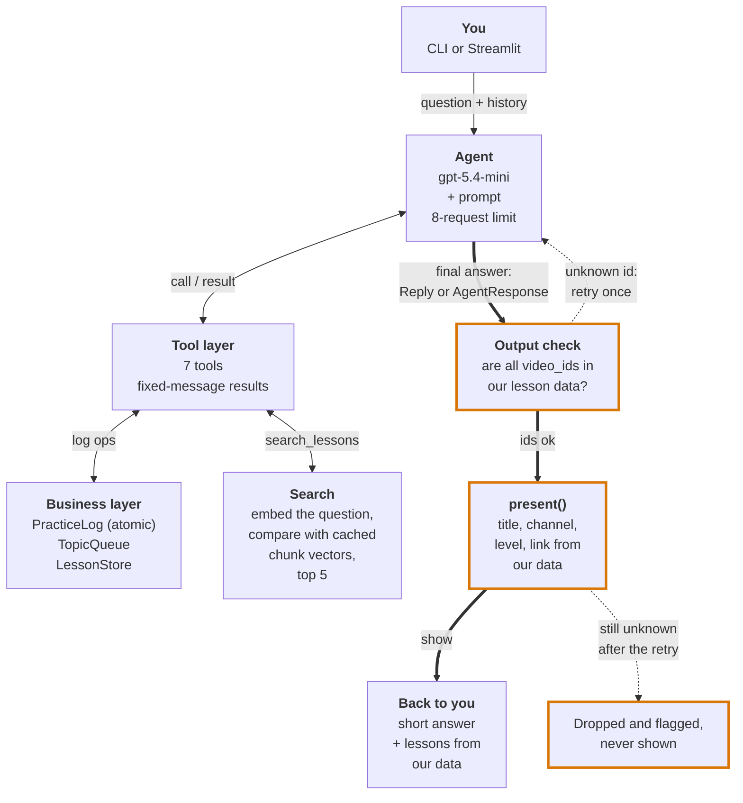
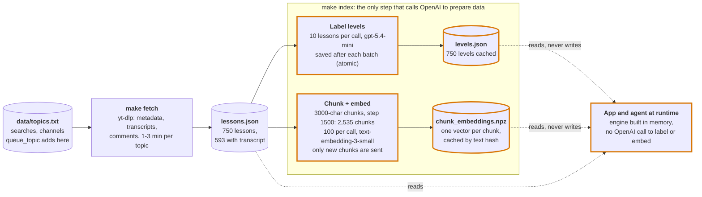
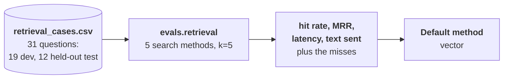

# Flow diagrams

Three views of the system, for anyone reading or evaluating the code: how one question travels through the agent, how the data behind it is prepared, and how the agent is measured. GitHub draws the diagrams from the text below. Orange outlines mark what the latest changes added.

1. [One question, end to end](#1-one-question-end-to-end)
2. [How the data gets ready](#2-how-the-data-gets-ready)
3. [How the agent is measured](#3-how-the-agent-is-measured)

## 1. One question, end to end

The model chooses tools and gives its answer. Code checks the lessons it recommends against the lesson data before anything reaches the screen.

- The model returns video_ids and a reason per lesson. It never writes a title or a link; code looks them up.
- A refusal, a history answer or a save confirmation uses `Reply`, which has no lessons field. That kept off-topic questions at 28 of 28 correct in the repeat test.
- One question costs about 2 to 3 model requests and 1 embedding call, roughly $0.007 to $0.01 on mini.

| Step | Where it lives |
|---|---|
| chat loop | `lick_finder/__main__.py` |
| agent, prompt, output check | `lick_finder/agent/agent.py` |
| tools and fixed messages | `lick_finder/agent/tools.py`, `tool_messages.py` |
| practice log, lesson data, topics | `lick_finder/business/` |
| search and embeddings | `lick_finder/integrations/search.py`, `embeddings.py` |
| filling in lessons | `lick_finder/agent/present.py`, `business/lessons.py` |

## 2. How the data gets ready

Fetching and indexing are offline steps you run yourself. The app only reads what they produce.

- Labelling used to run inside the first search, one call per lesson. It now takes 80 calls instead of 750, in batches of 10, and saves safely after every batch.
- If the embeddings are missing, search returns a fixed "index not built" message to the agent instead of calling OpenAI in the middle of a question.
- Level labels come from `gpt-5.4-mini`, because it agreed with the existing levels 83% of the time on a sample. Nano agreed 71%.

| Step | Command | Where it lives |
|---|---|---|
| fetch | `make fetch` | `integrations/youtube_data.py` |
| label and embed | `make index` | `integrations/index.py`, `levels.py`, `embeddings.py` |
| safe file writes | `write_text_atomic` | `integrations/files.py` |

## 3. How the agent is measured

Scenarios run against the real agent, answers get labelled good or bad, and a judge is scored against those labels. Real questions from Logfire flow back in as new scenarios.

```mermaid
flowchart LR
    scen[("<b>scenarios.csv</b><br/>65 scenarios")]
    run["<b>run_scenarios</b><br/>agent on a temp<br/>copy of your data,<br/>tool check<br/>+ LLM judge"]
    res[("<b>results.csv</b><br/>answers, tools,<br/>cost, verdicts")]
    lab["<b>label_app</b><br/>good / bad,<br/>one click,<br/>+ failure type"]
    labels[("<b>labels.csv</b><br/>saved next to<br/>each results file")]
    judge["<b>run_judge</b><br/>judge vs labels:<br/>accuracy,<br/>precision, recall"]
    prompt["<b>Edit the<br/>judge prompt</b><br/>fix what the<br/>disagreements show"]
    logfire["<b>Logfire traces</b><br/>real sessions"]
    l2c["<b>logs_to_cases</b><br/>candidate scenarios<br/>you review"]

    scen --> run --> res --> lab --> labels --> judge
    judge -->|"disagreements"| prompt
    prompt -->|"re-run"| judge
    logfire --> l2c
    l2c -->|"reviewed,<br/>then added"| scen
```

Search is scored on its own, without the agent:

- On the full 65 scenarios the agent passes the tool check 63 times. The two misses (#14 and #33) look up history and then stop without acting.
- The judge prompt loop, v1 to v2, raised accuracy from 65% to 77% on 60 labels.
- The 60 labels so far were written by an AI assistant, not by the repo owner, so the judge numbers show agreement with it. Hand labels made with `make label` would replace them.
- The held-out test questions are only scored with `--test`, so tuning never sees them.

| Step | Command | Where it lives |
|---|---|---|
| run scenarios | `make eval` | `evals/run_scenarios.py` |
| label answers | `make label` | `evals/label_app.py` |
| score the judge | `make judge` | `evals/judge.py`, `run_judge.py` |
| score search | `make retrieval` | `evals/retrieval.py` |
| real questions to cases | `make logs-to-cases` | `evals/logs_to_cases.py` |
